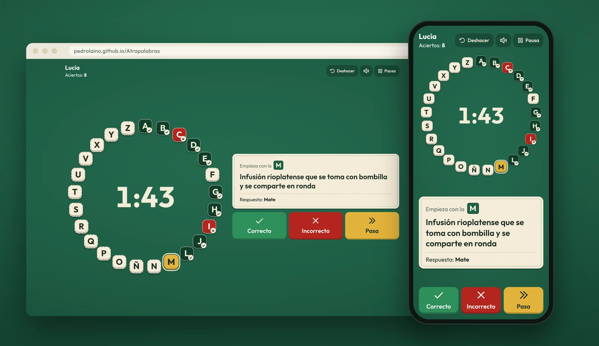
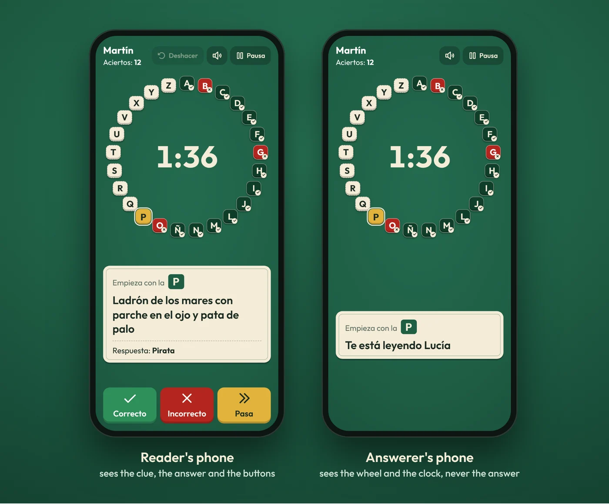
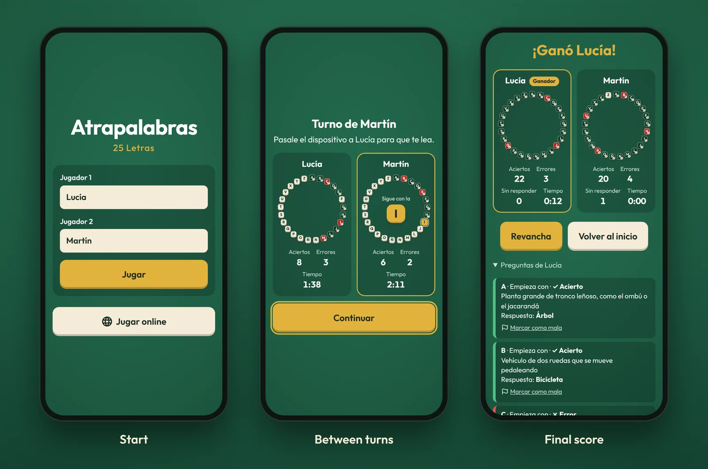
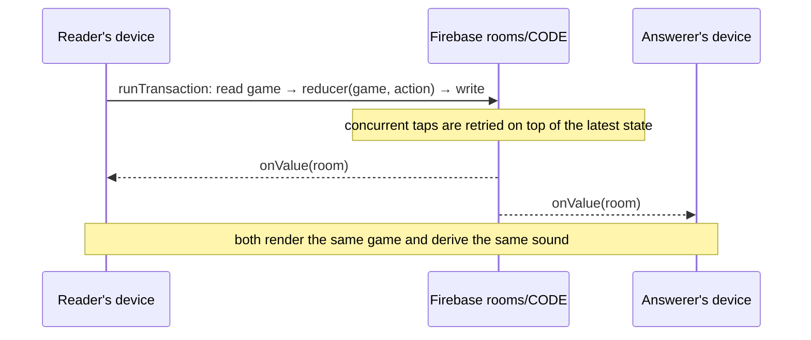

# Atrapalabras

A two-player alphabet quiz game for the browser — play on one device or online, each on your own phone.

[](https://github.com/pedrolaino/Atrapalabras/actions/workflows/deploy.yml)
[](LICENSE)
[](https://pedrolaino.github.io/Atrapalabras/)

**▶ [Play it live](https://pedrolaino.github.io/Atrapalabras/)**



> **Note on language:** the game and its 1,000 questions are in Spanish (it is meant for Spanish speakers); the code and documentation are in English.

## Features

- **Two ways to play:** pass a single phone or computer back and forth, or play **online**, each player on their own device (for example, while on a voice call).
- **A clock per player** (3 minutes each) that keeps exact time even if the tab is in the background or the phone is slow.
- **Undo** the last taps, including a wrong answer already shown on the between-turns screen.
- **Automatic pause** when the tab is hidden, the phone is locked or the page is reloaded; the game resumes exactly where it was.
- **Reconnection:** online, a reload or a dropped connection puts you back in the same room and seat.
- **No repeated questions:** each browser remembers which questions it has seen; online, the picker combines both players' histories.
- **Accessible:** a letter's status never relies on color alone (✓, ✗ and a dashed border), every letter is announced to screen readers, focus is always visible and reduced motion is respected.
- **Responsive, no scrolling:** the game screen fits exactly on a phone or a desktop; the answer buttons sit within thumb reach on phones.
- **Sounds and vibration** generated with Web Audio (no audio files), with a mute button.
- **Screen Wake Lock** keeps the screen on during a game.

## How to play

Each player has a wheel of 25 letters (the Spanish alphabet without K and W) and their own clock.

1. One player reads a clue aloud; the other has to say a word that **starts with** (or **contains**) the current letter.
2. The reader taps **Correcto** (the letter turns green and the same player continues), **Incorrecto** (it turns red and the turn ends) or **Pasa** (the letter stays pending for the next round and the turn ends).
3. Players alternate turns until both have finished their wheel or run out of time. If one finishes, the other keeps playing alone.
4. Most correct answers wins. Ties are broken by fewer wrong answers, then by less time used.

Online, the reader's device shows the clue, the answer and the buttons, while the answerer's device only shows the wheel and the clock:





## Tech stack

- **React 19 + TypeScript + Vite**
- **Vitest** and **Testing Library** for unit and UI tests, **Playwright** for end-to-end tests
- **oxlint** for linting
- **Firebase Realtime Database** and **Firebase Anonymous Auth** for online play (free Spark plan, no backend of its own)
- **GitHub Actions** and **GitHub Pages** for CI and hosting
- [Outfit](https://fonts.google.com/specimen/Outfit) and [Phosphor icons](https://phosphoricons.com/); everything else (audio, vibration, storage, timers) uses browser APIs

## Architecture & design decisions

### A pure reducer drives everything

All game rules live in [`src/game/reducer.ts`](src/game/reducer.ts): `(game, action) => game`. Actions are `START`, `CORRECT`, `WRONG`, `PASS`, `CONTINUE`, `UNDO`, `PAUSE`, `RESUME`, `TIME_UP` and `RESET`.

- **Time travels inside the action** (`now`). The reducer never reads the clock or `Math.random`, so the same actions always produce the same state. That makes it trivial to test and lets two devices reach the same state.
- **Questions are picked outside the reducer** and arrive already chosen in `START`. Online, a single device picks them and the other just receives the result.
- **The state is plain, serializable JSON** — no dates, classes or functions — so it can be saved to `localStorage` or Firebase as is.
- **The same reducer runs locally and online.** The React components only render the state and dispatch actions.

### Clocks from timestamps

A clock is never decremented tick by tick. The state stores when the current player's clock started and how much time was left; the remaining time is `left − (now − startedAt)`. Nothing drifts when the tab is throttled, and a tap that arrives after time ran out counts as time up, not as an answer.

### Lightweight undo

Before each tap the reducer stores a small snapshot (statuses, current index and who is playing), up to 30 of them. Undo restores the board but never refunds or charges time, and starting the next turn clears the history.

### Online sync with Firebase transactions



- Syncing sits behind a small [`Connection`](src/online/connection.ts) interface (create a room, join, subscribe, dispatch, delete if expired). There is a Firebase implementation and an in-memory one, and both pass the same test suite.
- **Every tap is a transaction**: the stored game is read, the reducer is applied and the result is written. If both players tap at once, Firebase applies one and retries the other on top of it.
- **Shared time:** each device corrects its clock with Firebase's server-time offset, so both compute the same remaining time. The correction only applies inside a room.
- **Late or repeated taps are ignored:** every answer carries the question id and turn number that were on screen. If the game has moved on (a double tap, or the other device tapped first), the reducer drops it. Taps are also ignored for a moment right after a new question appears.
- **Sounds come from state changes**, not from the button pressed, so both devices play the same sound.
- The game is stored as a JSON string, because Firebase drops `null`s and empty arrays.

### Identity and security rules

There is no sign-up: each device signs in with a **Firebase anonymous identity**, persisted in the browser. A room records the identities of its two players, and [`database.rules.json`](database.rules.json) only lets those two write to it:

- Joining may only take the free seat, with your own identity, without touching anything else.
- Names, identities and the creation time are immutable; sizes are capped (names up to 20 characters, the game up to 200 KB) and unknown fields are rejected.
- Room codes must be 4 valid letters, rooms cannot be listed and nothing can be written outside `rooms/`.
- **Rooms expire:** 6 hours after the last change, or 30 minutes after the game ends. The rules never accept an expiry more than 6 hours away and only let non-players delete a room once it has expired. Each device deletes the expired rooms it was in when it opens online mode.

### Defensive by default

- Everything that comes from outside — a room from Firebase, a saved game, the question files — is validated before use; a malformed game is discarded instead of breaking the screen, and an error boundary offers to start over if rendering still fails.
- A **Content Security Policy** is injected at build time (GitHub Pages cannot set headers): scripts and connections are limited to the app itself, Firebase and Google Fonts.
- **Firebase is lazy-loaded** only when entering online mode, so single-device play never downloads it.
- GitHub Actions are pinned to commit SHAs and each job has only the permissions it needs.

## Project structure

```text
src/
├── game/           Pure game logic: types, reducer, clock, scoring, question picking and validation, storage
├── components/     React screens (start, game, between turns, final) and the letter wheel
├── online/         Online rooms: Connection interface, Firebase and in-memory implementations, lobby and room screens
├── ui/             Hooks (clock, wake lock, keyboard shortcuts) and Web Audio sounds
├── data/           Question bank (one JSON file per letter) and its loader
└── config.ts       Game settings: time per player, letters, undo limit…
e2e/                Playwright scripts that play full local and online games
database.rules.json Firebase security rules
```

## Getting started

Requirements: [Node.js](https://nodejs.org/) 22 or later.

```bash
npm install
```

```bash
npm run dev
```

Then open http://localhost:5173/Atrapalabras/.

```bash
npm run build
```

The production build goes to `dist/` and can be served locally with `npm run preview`.

## Testing

| Command | What it covers |
|---|---|
| `npm test` | Vitest: the reducer, clocks, scoring, question picking and bank validation, storage, sound derivation, the in-memory online connection, and the React screens with Testing Library (jsdom). |
| `npm run lint` | oxlint. |
| `npm run test:online` | The same connection tests against the Firebase emulators (Realtime Database + Auth), including the security rules. Requires Java. |
| `npm run e2e` | Playwright plays two full games (phone and desktop): passes, wrong answers, undo, pause, keyboard shortcuts, a reload mid-game, one player finishing first, running out of time, flagging a question; it also checks the game screen never scrolls and that the CSP blocks nothing. |
| `npm run e2e:online` | A full online game between a phone and a desktop against the emulators: creating and joining a room by link, both roles, undo, pause, a reload mid-turn, the final screen and a rematch without repeated questions. |

The end-to-end scripts need Playwright with Chromium (`npm install --no-save playwright && npx playwright install chromium`) and a served build:

```bash
npm run build && npx vite preview
```

```bash
npm run e2e
```

For the online run, start the emulators, build the app pointing at them and serve it:

```bash
npx firebase-tools emulators:start --only auth,database --project atrapalabras-c3577
```

```bash
VITE_FIREBASE_EMULATOR=127.0.0.1:9000 npm run build && npx vite preview
```

```bash
npm run e2e:online
```

Screenshots are saved to `e2e/screenshots/` (ignored by git).

## Question bank

The bank has 1,000 questions, 40 per letter, in [`src/data/questions/`](src/data/questions/): one file per letter (`a.json` … `ñ.json` … `z.json`), each an array of:

```json
{
  "id": "m-011",
  "letter": "M",
  "type": "startsWith",
  "clue": "Infusión rioplatense que se toma con bombilla y se comparte en ronda",
  "answer": "Mate",
  "difficulty": "easy"
}
```

| Field | Meaning |
|---|---|
| `id` | Unique across the bank (`a-001`, …; Ñ uses `enie-001`). The no-repeat history is keyed on it, so ids never change. |
| `letter` | The file's letter, uppercase. |
| `type` | `startsWith` or `contains`: whether the answer starts with or contains the letter. |
| `clue` | The definition read aloud. |
| `answer` | The expected answer. |
| `difficulty` | `easy`, `medium` or `hard`. |

The files are bundled as raw text and validated when the app starts: valid JSON, at least two questions per letter (the players never share one), unique ids, the right letter, valid `type` and `difficulty`, and an answer that really starts with or contains the letter (ignoring accents, without confusing Ñ and N). If anything is wrong, the app lists the file and question to fix instead of showing a blank page, and a unit test runs the same validation on the real bank, so CI catches a broken file.

## Deployment

[GitHub Actions](.github/workflows/deploy.yml) runs lint, tests and the build on every pull request. Every push to `main` also deploys `dist/` to GitHub Pages; the app is built for the `/Atrapalabras/` base path.

The Firebase security rules are deployed separately: publish [`database.rules.json`](database.rules.json) in the Firebase console (Realtime Database → Rules) or with `firebase deploy --only database`. The Firebase web config in [`src/online/firebaseConfig.ts`](src/online/firebaseConfig.ts) is public by design; access is controlled by the rules and anonymous authentication.

## License

[MIT](LICENSE) © pedrolaino
